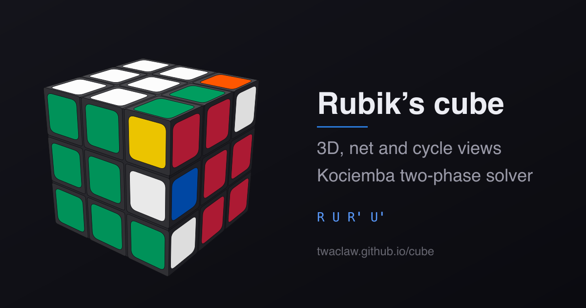

# cube

A Rubik's cube representation implemented in Rust, in the browser, on the
command line and from Python.

**[Try it online](https://twaclaw.github.io/cube/)**  |
[The algorithm, written up](https://twaclaw.github.io/posts/projects/rubik/)

[](https://twaclaw.github.io/cube/)

The app uses [trunk](https://trunk-rs.github.io/trunk/) to export to web assembly. It consist of two main components:

- A web app with the visualizations and solver (Kociemba's two phase algorithm), and
- A thin Python API (via PYO3) making the visualizations and animations availables to a Python client (e.g., a marimo notebook).


## What it does

- **Different views, one state.** Different views of a cube state: 3d with zoom and rotation, unfolded, disjoin cycle notation.
- **Moves.** Type a sequence and press enter to load it and execute it either in play or step mode.
- **Enter a cube.** A cube editor: the state as the 54-letter string the rest
  of the program speaks, or facelet by facelet on an unfolded grid. Each menu
  offers only the colors that still leave a cube that can be finished, so the
  grid cannot be painted into a dead end, and whatever follows from what you
  entered is filled in. 36 facelets at worst, 33 on average, rather than 48.
  While it is open the 3D view and the net show the cube as entered so far, and
  a sticker can be picked in any of the three and colored from the strip under
  the grid.
- **Camera.** Inside the editor, a button opens the camera and reads a real
  cube, one face at a time, each shot shown as a diagram of how to hold it. A
  face whose centre is not the colour asked for is refused rather than filed
  under the wrong name. The reading is a proposal, not a verdict: the
  stickers it was sure of go in first, a doubtful one only if it can still be
  true beside them, and anything left over stays open with its menu ready. A
  misread sticker is a hole to fill, not a scan to redo.
- **Scramble / solved / solve.** One button for a random state, one for the
  solved cube, and one that solves it: Kociemba's two-phase algorithm, in about
  20 moves and a few milliseconds. 
- **Optional Facelet numbers** 
- **Highlights.** Click a facelet to ring it, or list numbers such as
  `1,3,8-11`. This is how the notebooks mark the facelets that break an
  invariant of the group $H = \langle U, D, R^2, L^2, F^2, B^2\rangle$.
- **Exports** for a blog, all from the same renderer.
- **Any cube size.**  support for visualizing cubes of different sizes (but the solver is only for $3\times 3$).

## Notation

The parsers reads different notations and they can be mixed.

| written | means |
|---|---|
| `U D L R F B` | quarter turn of that face, clockwise |
| `u d l r f b` | the same turn counter-clockwise, so `rfu` is `R' F' U'` |
| `'` `2` $\cdot^2$ $\cdot^{-1}$ | inverse, half turn, SageMath style exponents |
| `M E S` | middle slice, following L, D and F |
| `*F` `>F` | slice and whole-cube turn, as in geometer.org's *Rubik* |
| `x y z` | whole-cube turns |
| `Rw` `2R` `2-3R` | wide and deep layers, for bigger cubes |
| `(R U)3` `(R U)'` | repeat a group, or invert it |

`R^2*U*F^-1` (the notebooks' SageMath product) and `R2 U F'` (WCA) both parse,
as does the crammed `rfu` of the *Rubik* macro language. A `*` between two
moves is read as the SageMath product; a `*` that starts a move is the slice
prefix.

## From Python, and from a notebook

The same renderer, as a Python module (I wanted a marimo notebook but can be any Python client).
See [cube.py](./notebooks/cube.py) and [crates/cube-py/README.md](./crates/cube-py/README.md).

```sh
pip install magic-cube
```

```python
import magic_cube as mc

cube = mc.Cube()
cube.apply("R U R' U'")
cube.view3d(yaw=38, pitch=24)
```

The wheels are abi3, so one per platform covers every CPython from 3.9 up and
nothing needs a Rust toolchain to install. The import name is `magic_cube`,
with an underscore: `magiccube` on PyPI is an unrelated cube library, which is
why the distribution is `magic-cube` rather than that.

```sh
make python         # maturin develop: builds magic_cube into .venv
make notebook       # opens notebooks/cube.py in marimo
make post           # runs the notebook, writes figures/, exports cube.md
make release-check  # builds the wheel and the sdist, checks the metadata
```

Releasing is a tag: push `py-v<version>` and
[release.yml](./.github/workflows/release.yml) builds wheels for Linux, macOS
and Windows plus a source distribution, then publishes to PyPI by trusted
publishing. The version comes from `crates/cube-py/Cargo.toml`.


## Exports

| export | what it is good for |
|---|---|
| 3D view, SVG | a still of the current state and camera |
| net, SVG | the flat diagram, with numbers and rings if shown |
| every step, one SVG | the whole maneuver as a grid of labeled states |
| animated SVG | SMIL flipbook; works inside ``, so it drops into Markdown |
| animation, HTML page | self-contained player with play, step and scrub |
| mosaic, animated SVG | the grid of states filling itself, each cube arriving mid turn |
| mosaic, HTML page | the same grid, with play, step and scrub |
| embed snippet | an `<iframe>` of the live app, state and all, still interactive |

A mosaic is the grid and the animation at once: every state lands in a cell
of its own, and the turn that reaches it plays inside that cell as the cube
fades in. Rows share one clock, so `--meet` draws a search coming at a solution
from both ends: the scramble walking forwards along the top row, the solved
cube walking backwards along the second, the two stopping on the same state in
the same column, and a third row then carrying the whole solution across. Each
row can be named in the margin, rest on each state it lands, run at a speed of
its own, and write labels of your own under its cubes in place of the move
names. The two cubes the searches met on are framed the moment they
coincide.

The same drawings come out of the command line exporter:

```sh
cargo run -p cube-export -- --help
cargo run -p cube-export -- -s "R U R' U'" --mode strip -o steps.svg
cargo run -p cube-export -- --mode net --numbers --highlight 1,3,8-11 -o net.svg
cargo run -p cube-export -- -s "R U R' U'" --mode mosaic --columns 5 -o grid.svg
cargo run -p cube-export -- --scramble 6 --seed 3 -s "F2 D B2" --meet "U' F' L" \
    --mode mosaic --size-px 130 -o meet.svg
```

The app reads its own state from the query string, which is what the embed
snippet uses: `?n=3&seq=R+U+R%27+U%27&cam=38,24&numbers=1&hl=1,3&embed=1&autoplay=1`.
`views=3d`, `views=net` or `views=perm` shows one view only, and a comma list
such as `views=3d,perm` shows just those; `controls=1` keeps the console in an
embed, with its view select narrowed to the views `views` names.
`title-3d=`, `title-net=` and `title-perm=` put a small header on top of that
view.

## Running it

```sh
make dev                                           # live reload, http://127.0.0.1:8088
make preview PUBLIC_URL=/cube/ PREVIEW_PORT=...    # the release build, served from that path
make test                                          # unit, property and SageMath comparison tests
make build PUBLIC_URL=/cube/                       # the bundle GitHub Pages serves
```


## Structure

```
crates/cube-core     state, moves, notation, the SVG renderers, solver, exports
crates/cube-graphs   figures the app does not need: the tables and the searches
                     drawn as trees, for the notebooks and the book
crates/cube-web      the browser front end (wasm-bindgen and web-sys only)
crates/cube-export   the same exports from the command line
crates/cube-py       the same drawings as a Python module (maturin, outside
                     the cargo workspace: it links against the interpreter)
notebooks            a marimo notebook with one example of each view
```

- **Geometry.** A facelet is a point on a doubled, centered integer lattice plus
  an outward normal, so a quarter turn is an exact integer rotation. One
  `Turn { axis, lo, hi, quarters }` covers face turns, wide turns, slices and
  whole-cube rotations, at any size. Nothing is tabulated per move.
- **3D rendering.** Perspective projection, back-face culling, painter's
  algorithm. Each group of cubies that moves together sits on a dark body box,
  which fills the grooves and the face a turn cuts open; inner cubie faces are
  then never drawn, which halves the output.
- **Framing.** The scale comes from the sphere the cube turns inside, so the
  view neither breathes while you drag nor clips a layer at 45 degrees.
- **Correctness.** The move permutations and the cycle notation are checked
  against SageMath's `CubeGroup`, string for string (`make vectors` regenerates
  the table), and the rest is property
  tested with proptest: four quarter turns are the identity, a maneuver is
  undone by its reverse, colors are never created or destroyed, the numbering
  is a bijection, the drawing always fits its viewBox, a face-on view shows
  exactly one face, and so on.


## Credits

- The facelet numbering, the net layout and the color scheme follow SageMath's `sage.groups.perm_gps.cubegroup`. The macro language and the slice and whole-cube prefixes come from Tom Davis's [*Rubik*](http://www.geometer.org/rubik/) and its user guide.
- This is continuation of previous work of mine, see [this blog post](https://twaclaw.github.io/posts/projects/rubik/) and this [repository](https://github.com/twaclaw/rubik) describing different algorithms for solving Rubik's cube.
- [Kociemba's page](https://kociemba.org/)
- [Kociemba's original solver](https://github.com/hkociemba/RubiksCube-TwophaseSolver)